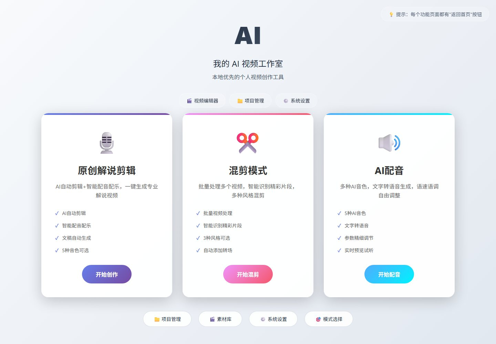
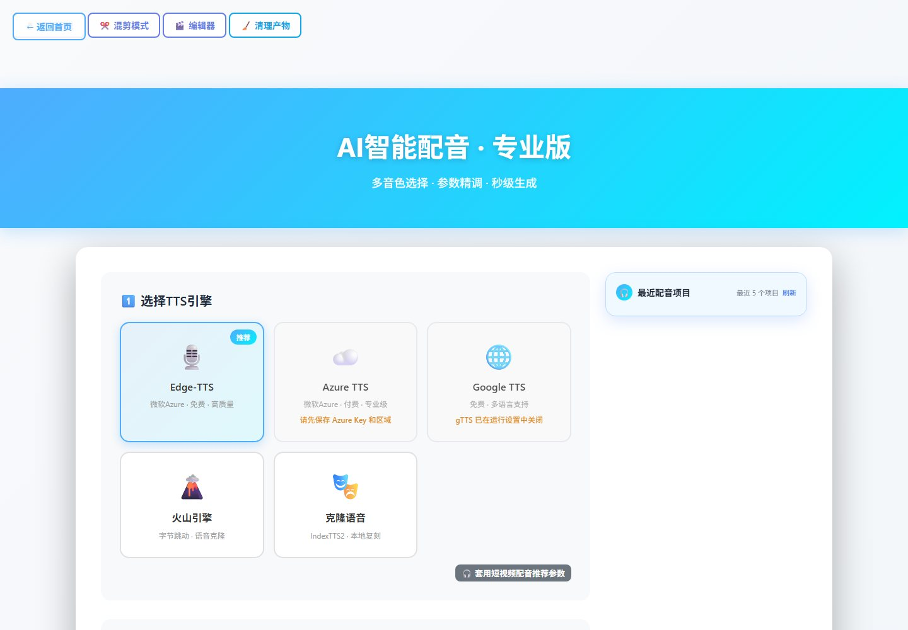

# JJYB AI 智剪 · 二次开发说明（非官方）

> 本仓库记录我在一个第三方 AI 视频剪辑工具上做的**缺陷修复与健壮性改造**。
> **不是我的原创项目，也不是上游官方版本。仓库只含说明文档与截图，不含任何源码与安装包。**

上游：[jianjieyiban/JJYB_AI_VideoAutoCut](https://github.com/jianjieyiban/JJYB_AI_VideoAutoCut)
上游许可：**JJYB_AI_VideoAutoCut Personal Use License v1.0**（源码公开，但**非开源**、禁止商用与再分发）

---

## 一、先说明边界

- 这个工具的界面、模板体系、任务调度、混剪/配音/声音复刻/剪映草稿导出等能力，**都是上游作者实现的**，不是我写的。
- 我做的是在本地副本上改动 **27 个文件、+348 / −66 行**，集中在「分镜规划、音画同步、解说文案、配置驱动」四条线上。
- 上游许可是个人使用许可：**不得商用、不得再分发、不得去署名、不得用混淆名称发布衍生品**。
  因此这个改造版不公开源码、不提供安装包，本仓库也不构成任何形式的再发布。
- 界面中出现的应用名「我的 AI 视频工作室」来自 `config/config.yaml` 的配置项（我做的品牌配置化改造），
  `attribution` 字段始终保留「基于 JJYB_AI_VideoAutoCut 改造」，不隐藏上游来源。

## 二、界面

应用名、副标题、版本号全部来自配置，模板通过上下文变量渲染——换名不需要再满仓库改字符串。

## 三、改了什么（每条都对应真实代码位置）

### 1. 分镜规划：短镜头不再让整条规划失败

`backend/engine/storyboard_planner.py`

原逻辑里，如果某个镜头的可用时长小于它那段配音的时长，这个镜头会被**直接跳过**；
当所有候选都被跳过时，规划直接抛 `not enough source material`，任务在开始渲染前就死了。

改造后：把「可用但不够长」的短镜头**保留为候选**（只要求 `available >= MIN_WINDOW_SECONDS`），
把「把画面补到配音长度」的责任交给渲染阶段；并新增 `allow_reuse` 开关，
素材池不够时退化为**循环复用画面窗口**，保证仍能出片。
同时把报错信息补上每段 `idx / duration` 明细，能直接看出是哪段素材太短。

### 2. 音画同步：短镜头自动定格 + 末帧克隆兜底

`backend/engine/puppet_sync_engine.py`

- 当 `目标时长 > 源画面时长` 时，策略自动从 `direct / cut_highlight` 切到 `freeze`（原画面 + 末帧定格），
  避免截出一段比配音短的画面。
- 部分编码器/关键帧边界会让慢放或定格滤镜输出**少几帧**，原逻辑会因此判定失败并中止整条成片。
  现在增加最后一道兜底：用 `tpad=stop_mode=clone` 克隆末帧补齐到目标时长并 `trim` 收口；
  正常路径仍走严格时长校验，兜底只在异常时触发。
- 另外把「未知片段策略」从静默 `return None` 改成显式抛错，避免问题被吞掉。

### 3. 解说文案：没有视觉模型时强制「严格视觉锚定」

`backend/services/commentary_service_enhanced.py`

本地分析只能给出亮度、色彩等弱标签。这种情况下再套「悬念 / 反转」模板，
模型会**凭空生成与画面无关的剧情**。改造：检测到没有可用的云端视觉模型
（或没有有效的增强描述）时，自动开启 `strict_visual_grounding`，
禁用剧情脑补，只允许基于画面可见证据的客观表达。

### 4. 原创解说：多视频批量上传与自动合并

`backend/api/upload_routes.py`（新增 `POST /api/upload/merge-videos`）+ `frontend/templates/commentary.html`

支持一次上传多段素材，按顺序合并成一个主素材再进入解说流程。
合并前会校验每个路径都必须落在项目目录内，避免任意路径读取。

### 5. 品牌配置驱动

`frontend/app.py`（新增 `APP_IDENTITY` + `context_processor`）、`config/config.yaml`、21 个模板

应用名 / 副标题 / 版本 / 上游署名统一从配置读取，模板用 `app_identity` 渲染。
`attribution` 是刻意保留的字段：品牌化不等于抹掉来源。

### 6. 浏览器模式：绕过 WebView2 的 POST/fetch 拦截

`frontend/app.py`

部分 Windows 环境的 WebView2 会拦截页面内的 POST / fetch，表现为「点了没反应」。
新增浏览器模式：用系统浏览器访问同一个 Flask 服务，绕开桌面容器限制。

### 7. 火山 Seed Audio V3 配音通道

`backend/api/settings_api.py`、`frontend/templates/settings.html`

新增 v3 协议（`X-Api-Key` 头，不再用旧的 app / token / voice_type 三段式），
带「连接测试」，密钥打码回填时不会被明文覆盖。

## 四、技术栈（上游技术栈，非我引入）

Python · Flask · PyWebView（含浏览器模式）· FFmpeg · OpenCV · PyTorch + YOLOv8 · faster-whisper · SQLite

## 五、为什么没有源码

1. 上游许可禁止再分发与商用，公开源码或安装包都越界。
2. 这是对别人作品的修改，公开源码容易被误认为我的原创项目——这一点我不想含糊。

需要了解具体实现细节，可以在 Issues 里问，我可以贴出**我自己写的那部分改动**的关键代码片段。

## 六、想读代码？

- 上游源码是公开的：https://github.com/jianjieyiban/JJYB_AI_VideoAutoCut
- 我自己的项目（源码可见，非开源）：
  [星河制片台](https://github.com/linweinanlin/xinghe-production-desk-showcase) ·
  [AI 短剧自动化工作台](https://github.com/linweinanlin/ai-drama-workbench-showcase)
